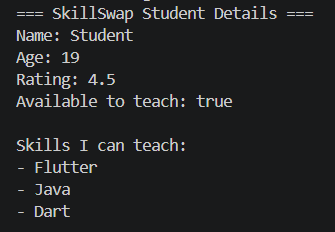

# SkillSwap – Flutter Lab Experiments

**Technology Used:** Flutter and Dart

This repository contains 10 experiments demonstrating the step-by-step development of the SkillSwap application, a platform where students can connect and exchange skills.

---

## Experiment 1 – Dart Basics

**Description:** Introduces the fundamentals of Dart programming, including variables, data types, operators, conditional statements, loops, lists and functions.

**Output:**

---

## Experiment 2 – Widgets and Layouts

**Description:** Explores basic Flutter widgets such as Text, Container, Image, Row, Column and Card to design the SkillSwap home screen.

**Output:** To be added.

---

## Experiment 3 – Responsive UI

**Description:** Develops a responsive user interface using Flutter layouts and screen-size properties so the application adjusts to different screen sizes.

**Output:** To be added.

---

## Experiment 4 – Navigation

**Description:** Implements navigation between different screens using Flutter navigation techniques, allowing users to move through the application.

**Output:** To be added.

---

## Experiment 5 – State Management

**Description:** Demonstrates state management to update the user interface dynamically when application data changes.

**Output:** To be added.

---

## Experiment 6 – Custom Widgets

**Description:** Creates reusable custom widgets for elements such as skill cards, profile sections and buttons to maintain a consistent design.

**Output:** To be added.

---

## Experiment 7 – Forms and Validation

**Description:** Develops input forms for user registration and profile details, including validation to ensure correct user input.

**Output:** To be added.

---

## Experiment 8 – Animations

**Description:** Adds Flutter animations and transitions to improve the appearance and interactivity of the SkillSwap application.

**Output:** To be added.

---

## Experiment 9 – REST API Integration

**Description:** Integrates REST APIs to fetch data from external sources and display the retrieved information in the application.

**Output:** To be added.

---

## Experiment 10 – Testing and Debugging

**Description:** Performs application testing, identifies errors and uses debugging techniques to improve the reliability and performance of the application.

**Output:** To be added.

---

**Project:** SkillSwap – A student skill-sharing platform developed using Flutter and Dart.
